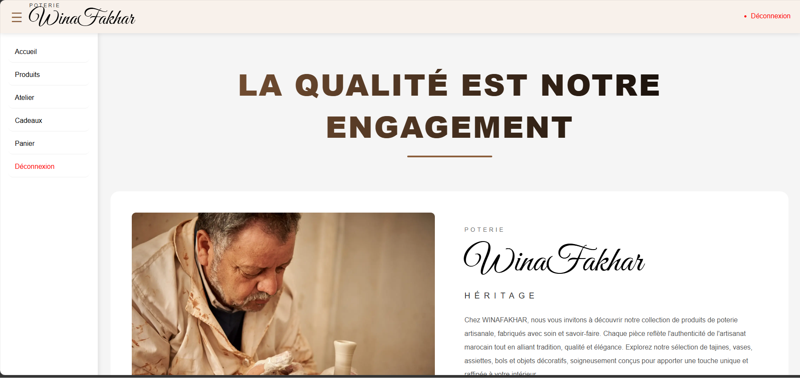
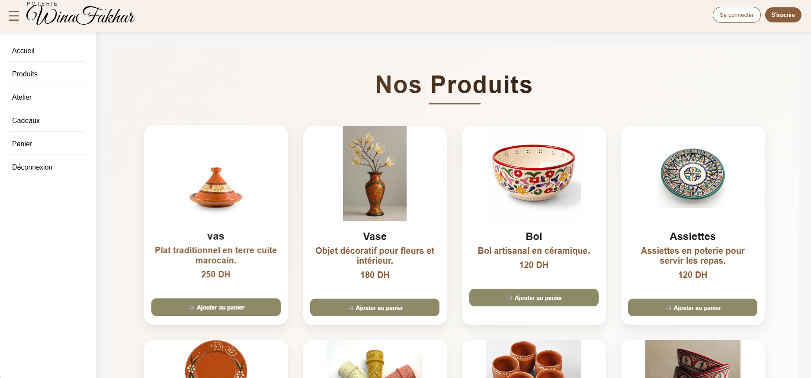
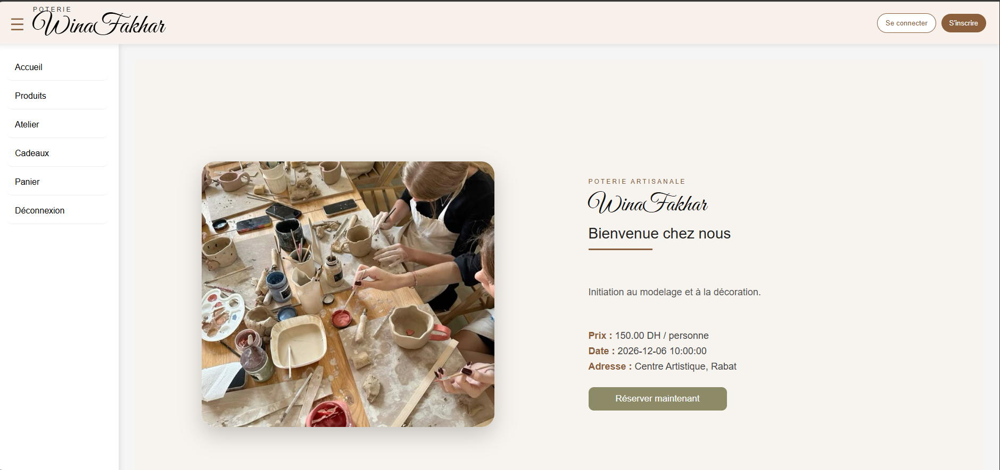
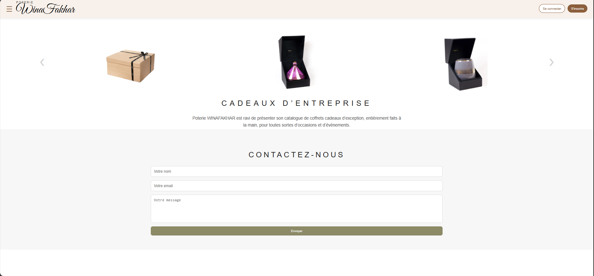
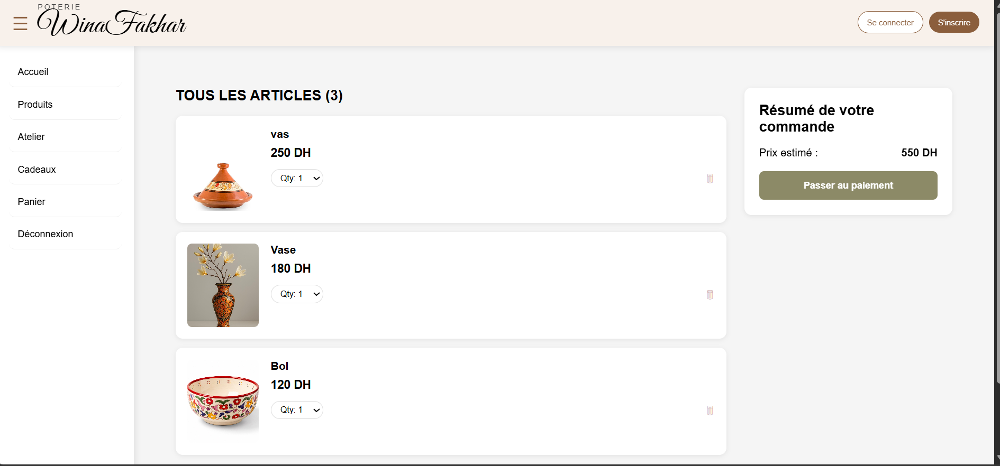
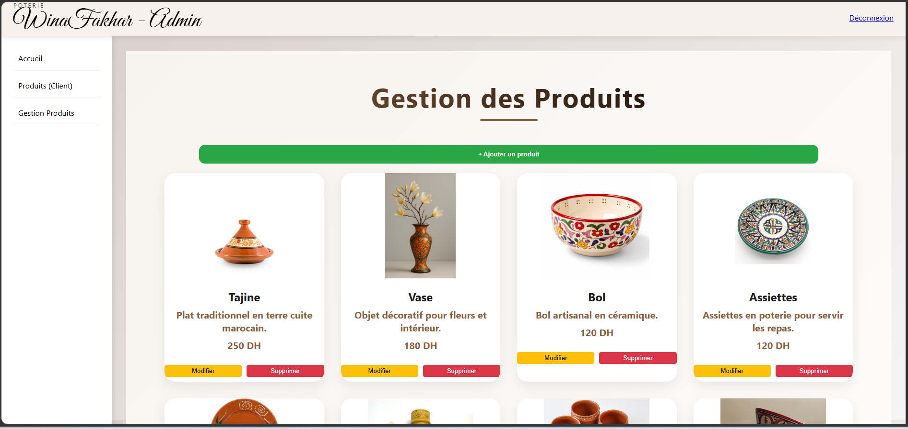
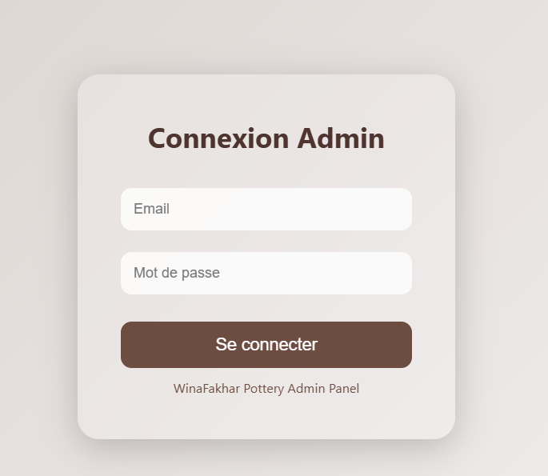

# WinaFakhar – Pottery E-commerce Platform

WinaFakhar is a full-stack pottery e-commerce application that allows users to explore pottery products, manage their shopping cart, place orders, and reserve pottery workshops.

The project uses **React.js** for the frontend and **Laravel** for the backend API, database management, and administration pages.

## Technologies Used

- **Frontend:** React.js, JavaScript, CSS
- **Backend:** PHP, Laravel
- **Database:** MySQL
- **Architecture:** REST API

## Main Features

- Browse and explore pottery products.
- View product details and categories.
- Add products to the shopping cart.
- Register and log in.
- Place orders.
- Reserve pottery workshops.
- Send contact messages.
- Admin dashboard for product management.
- Manage registrations, orders, workshop reservations, and contact messages.

## Project Structure

```text
WinaFakhar/
├── backend/       # Laravel application and API
├── frontend/      # React application
├── README.md
└── .gitignore
```

## Installation and Setup

### 1. Clone the repository

```bash
git clone https://github.com/WIA-AFQ/Pottery-Project.git
cd Pottery-Project
```

### 2. Backend Setup

Open a terminal:

```bash
cd backend
composer install
```

Create your environment file:

```bash
Copy-Item .env.example .env
```

Generate the application key:

```bash
php artisan key:generate
```

Configure your MySQL database in `backend/.env`. The default database name is `pottery_db`.

Create the database in MySQL, then run:

```bash
php artisan migrate
php artisan db:seed
php artisan serve
```

The Laravel backend will be available at:

`http://127.0.0.1:8000`

### 3. Frontend Setup

Open another terminal:

```bash
cd frontend
npm install
npm start
```

The React application will be available at:

`http://localhost:3000`

##  Admin Access

The Laravel admin panel is available at:

`http://127.0.0.1:8000/admin/login`

A sample administrator account is created locally by the database seeder.

For security reasons, login credentials are not included in this documentation.

**Important:** Change the default password before using the application outside local development.
## Screenshots

### Home Page

### Products

### Ateliers

### Cadeaux

### Panier

### AdminProduits 

### Login


## Important Notes
- The admin login and product management pages are built with Laravel Blade.
- Products, user registrations, orders, workshop reservations, and contact messages are handled by Laravel.
- The React storefront keeps the shopping cart in the browser until checkout.
- Laravel calculates order totals using product prices stored in the database.
- Card payment is currently recorded as a selected payment method. No external payment provider is integrated yet.

## Author

**Wiam Bouazizi**

